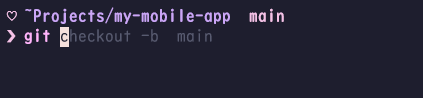
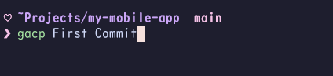

# Cute Tokyo Terminal Theme

<p align="center">
  
</p>

A soft pastel terminal setup built from **Zsh**, **Starship**, **Tokyo Starry Night**, Nerd Fonts, and a few quality-of-life CLI tools.

It supports:

- **macOS** with **iTerm2**
- **Windows 10/11** with **Windows Terminal + WSL2 + Ubuntu**

## What it does

- **Command suggestions as you type**: zsh-autosuggestions shows a greyed-out completion based on your history. Press `→` to accept it.
- **Typo detection before you hit Enter**: zsh-syntax-highlighting colors valid commands, options, strings and paths, and turns unknown commands red.
- **Git status at a glance**: the Starship prompt shows the full current directory, the Git branch, and whether you have staged, modified or untracked files or are ahead or behind the remote.
- **Better `ls`**: `ls` and `ll` use eza, so you get icons, Git status per file, and folders listed first.
- **Readable file previews**: `cat` uses bat, which adds syntax highlighting and line numbers.
- **Smarter `cd`**: zoxide remembers the directories you visit, so `z <part-of-name>` jumps straight there and `zi` lets you pick one interactively.
- **Fuzzy search**: fzf powers `Ctrl + R` history search and fuzzy file and directory completion.
- **Node version management**: NVM is set up so you can switch between Node.js versions per project.
- **Git shortcuts**: `gacp <message>` adds, commits and pushes the current branch in one go, and `gcp` switches to `main` and pulls.
- **Safe install**: your existing `~/.zshrc` and `starship.toml` are backed up before anything is replaced, and `DRY_RUN=1` lets you preview the changes first.

## Contents
- [Installation](#installation)
  - [What gets installed](#what-gets-installed)
  - [macOS](#macos)
  - [Windows / WSL2](#windows--wsl2)
  - [Dry run](#dry-run)
- [Useful commands](#useful-commands)
  - [Files and folders](#files-and-folders)
  - [Navigation](#navigation)
  - [Git](#git)
  - [Node.js](#nodejs)
  - [Keyboard shortcuts (fzf)](#keyboard-shortcuts-fzf)
- [Theme layers](#theme-layers)
- [Files](#files)
- [Manual installation](#manual-installation)
- [Safety](#safety)

## Installation
### What gets installed

The installers configure:

- Zsh
- Starship
- JetBrainsMono Nerd Font support
- zsh-autosuggestions
- zsh-syntax-highlighting
- eza
- bat
- fzf
- zoxide
- NVM
- **Tokyo Starry Night** terminal colors
- custom pastel Starship and Zsh syntax colors
- the repository's `zshrc`
- the repository's `starship.toml`

Existing `~/.zshrc` and `~/.config/starship.toml` files are backed up with a timestamp before replacement.


### macOS
Clone the repository:

```sh
git clone https://github.com/Hanafubuki/cute-theme-terminal.git
cd cute-theme-terminal
```

Run:

```sh
bash install-mac.sh
```

The installer will:

1. Install Homebrew if it is missing.
2. Install iTerm2.
3. Install JetBrainsMono Nerd Font.
4. Install Starship, eza, bat, fzf, zoxide, NVM, autosuggestions and syntax highlighting.
5. Back up existing terminal configuration.
6. Install `zshrc` and `starship.toml`.
7. Detect the Homebrew prefix so both Apple Silicon and Intel Macs work.
8. Enable the macOS fzf integration.
9. Open `iterm-profile.json`, which contains the Tokyo Starry Night-style iTerm2 profile.
10. Set Zsh as the default shell when needed.

After it finishes, open a new iTerm2 window. If the font was not selected automatically, choose:

**iTerm2 → Settings → Profiles → Text → JetBrainsMono Nerd Font**

### Windows / WSL2

If WSL is not installed yet, open Administrator PowerShell and run:

```powershell
wsl --install
```

Restart Windows if requested, then open Ubuntu.

Clone the repository inside WSL:

```sh
git clone https://github.com/Hanafubuki/cute-theme-terminal.git
cd cute-theme-terminal
```

Run:

```sh
bash install-wsl.sh
```

The installer will:

1. Verify that it is running inside WSL.
2. Install the required Ubuntu packages.
3. Install eza, Starship, zoxide and NVM when missing.
4. Install Zsh autosuggestions and syntax highlighting.
5. Back up existing terminal configuration.
6. Convert the shared macOS-oriented `zshrc` to WSL paths automatically.
7. Handle Ubuntu's `bat` / `batcat` difference.
8. Enable Ubuntu fzf key bindings and completion.
9. Set Zsh as the default shell.
10. Detect your Windows username and replace `/mnt/c/Users/<name>` with `~` in the displayed Starship path.
11. Add the **Tokyo Starry Night** color scheme to Windows Terminal through its fragment system when Windows integration is available.
12. Check whether JetBrainsMono Nerd Font is already installed on Windows.

The Windows scheme uses the Tokyo Night Storm palette:

```text
Background  #24283B
Foreground  #C0CAF5
Red         #F7768E
Green       #9ECE6A
Yellow      #E0AF68
Blue        #7AA2F7
Purple      #BB9AF7
Cyan        #7DCFFF
```

After installation, select:

**Windows Terminal → Settings → Profiles → Ubuntu → Appearance → Color scheme → Tokyo Starry Night**

If the Nerd Font is not installed on Windows, the installer will tell you. Install it once from [Nerd Fonts](https://www.nerdfonts.com/font-downloads), then select it under:

**Windows Terminal → Settings → Profiles → Ubuntu → Appearance → Font face**

After installation, completely close Windows Terminal and reopen it.

### Dry run

Both installers support a dry-run mode for inspecting what they would do without installing packages or replacing configuration:

```sh
DRY_RUN=1 bash install-mac.sh
```

or:

```sh
DRY_RUN=1 bash install-wsl.sh
```

## Useful commands

<p align="center">
  
</p>

### Files and folders

List files with icons.
```sh
ls
```

Show a detailed list of all files, including hidden ones, with icons and Git status. Folders are listed first.
```sh
ll
```

Show a file with syntax highlighting and line numbers, using bat.
```sh
cat <file>
```

### Navigation

Jump to a folder you've visited before by typing part of its name, using zoxide.
```sh
z dashboard
```

Open an interactive fuzzy picker of the folders you've visited before.
```sh
zi
```

### Git

Add all changes, commit them with a message, and push the current branch.
```sh
gacp <commit message>
```

Switch to `main` and pull the latest changes.
```sh
gcp
```

### Node.js

Install and switch Node.js versions with NVM.
```sh
nvm install 20
nvm use 20
nvm ls
```

### Keyboard shortcuts (fzf)

- `Ctrl + R`: fuzzy-search your command history.
- `Ctrl + T`: fuzzy-search files and insert the path into the command line.
- `Alt + C`: fuzzy-search folders and `cd` into the one you pick.
- `**` + `Tab`: fuzzy completion, for example `vim **<Tab>` or `cd **<Tab>`.
- `→`: accept the greyed-out autosuggestion.

## Theme layers

The terminal theme and shell colors are separate:

- **Tokyo Starry Night** controls the terminal background and ANSI palette in iTerm2 / Windows Terminal.
- **Starship** controls the heart, prompt arrow, directory, Git branch and Git status colors.
- **zsh-syntax-highlighting** controls command, option, string, path and error colors as you type.

This means you can change the Starship/Zsh pastel accents without changing the Tokyo Starry Night terminal background.

## Files

```text
cute-theme-terminal/
├── README.md
├── README_MANUAL_INSTALL.md
├── install-mac.sh
├── install-wsl.sh
├── zshrc
├── starship.toml
├── iterm-profile.json
├── tests/
│   └── test_installers.sh
└── Brewfile
```

## Manual installation

For the complete manual setup, troubleshooting steps, color definitions, Windows Terminal JSON, Nerd Font instructions, and individual package commands, see:

**[README_MANUAL_INSTALL.md](README_MANUAL_INSTALL.md)**

## Safety

Before committing your own modified `.zshrc`, make sure it does not contain API keys, passwords, tokens, or other secrets.
